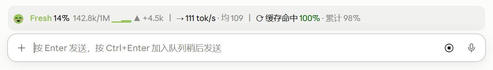
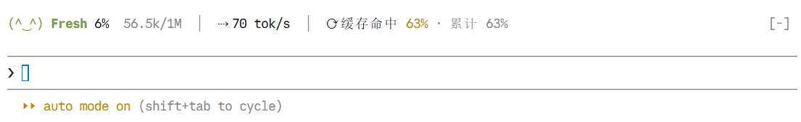

# token-pulse

中文 | [English](README.en.md)

Claude Code 的一个 mod：在输入框上方显示一条状态带，用来替代 token-weather。

```
(-_-) Tired 67%  134.4k/200k ▃▅█ ▲ +98.4k  │  ⇢ 68 tok/s · 均 72  │  ⟳ 缓存命中 94% · 累计 88%
```

### 桌面应用（Code 标签页）



### 终端（CLI）



## 精力值小人

上下文越满，小人越累；压缩上下文就是让它睡一觉。桌面应用（Code 标签页）里画成 SVG 小人，终端画不了图，显示为颜文字。

| 上下文占用 | 状态 | 桌面应用 | 终端 | 颜色 |
|---|---|---|---|---|
| < 25% | Fresh |  眯眼大笑、脸红 | `(^‿^)` | 绿 |
| 25–50% | Focused |  圆眼、浅笑 | `(•_•)` | 青 |
| 50–75% | Tired |  眼睛眯成线、打哈欠 | `(-_-)` | 橙 |
| 75–90% | Drained |  下垂眼、波浪嘴、冒汗 | `(=_=;)` | 珊瑚 |
| ≥ 90% | Exhausted |  睡着了，头顶 zZ | `(-_-)zZ` | 红，快压缩了 |

状态文字（Fresh、Tired 等）和趋势条也会用同一档颜色。

## 各项含义

| 项目 | 含义 |
|---|---|
| 67% | 当前上下文窗口占用 |
| 134.4k/200k | 已用 token 数 / 窗口大小 |
| ▃▅█ | 最近 12 轮结束时的上下文占用趋势 |
| ▲ +98.4k | 与上一轮相比上下文增减的 token 数 |
| ⇢ 68 tok/s | 最近一次模型请求的输出速度 |
| 均 72 | 最近 10 次有效请求的平均输出速度（按 token 加权） |
| ⟳ 缓存命中 94% | 最近一次请求的提示缓存命中率。绿色 ≥80%，黄色 ≥50%，红色 <50% |
| 累计 88% | 本会话所有请求的累计缓存命中率 |

终端较窄时（状态带不足 96 列）只显示小人、状态、占用、速度和命中率。窄屏模式只对终端生效：桌面应用报告的列数和终端算法不同，按同一阈值判断会把内容误藏，所以桌面应用始终显示完整内容。

## 计算口径

- **输出速度**：输出 token 数 ÷ 生成耗时。生成耗时从收到第一个流片段算起，到流结束为止，不含排队和首字延迟。数值在本机测得，会受网络影响；思考（thinking）token 计入输出。输出少于 20 个 token 或耗时不足 0.3 秒的请求不计入，避免噪声。
- **缓存命中率**：缓存读取 ÷（未缓存输入 + 缓存写入 + 缓存读取）。会话第一次请求、刚压缩上下文、或缓存过期（默认 5 分钟）后偏低是正常的。
- 只统计主对话；子代理（subagent）的请求不计入。`/clear` 后累计数据清零。

## 使用

- `/token-pulse`：显示或隐藏状态带。
- 首次模型响应之前不显示。
- 第一轮结束后显示占用、token 数、速度和命中率；趋势条、▲ 变化量和“均”需要至少两个数据点，从第二轮起出现。

## 安装

需要 Claude Code 2.1.287 或更高版本。在 Claude Code 的输入框里执行：

```
/plugin install token-pulse --marketplace gKev1n/token-pulse
```

按提示输入 `y` 添加插件市场，再选择安装范围。也可以在系统终端里执行：

```bash
claude plugin install token-pulse --marketplace gKev1n/token-pulse
```

已在运行的会话里执行 `/reload-plugins` 生效。

如果装着 token-weather，请先停用或卸载，否则两条状态带会同时出现。

想自己改代码的话，把仓库克隆到本机，改为添加本地文件夹：

```bash
git clone https://github.com/gKev1n/token-pulse.git ~/mods/token-pulse
claude plugin marketplace add ~/mods/token-pulse
claude plugin install token-pulse@token-pulse
```

之后修改这个文件夹里的文件，执行 `/reload-plugins` 即可生效，无需重装。

## 已知问题

- Windows 终端使用中文字体时，`•` 等字符可能显示成两格宽，颜文字会轻微错位。

## 开发

```bash
claude plugin validate .
claude plugin test .
```

- 判断绘制界面要看 `e.surface !== 'terminal'`。终端的元素表里也有 `Svg` 键，只用 `'Svg' in els` 判断会在终端里误画 SVG。
- 测试里的 `ui.render` 需要测试自己在最底层答一个（见测试文件里的 `engineDraws`）；`session.usage` 的底层答复要包成 `{ value: ... }`。
- `docs/images/mascot-*.svg` 由 `hooks/icon.ts` 的 `mascotSvg()` 导出。改了小人造型后，需要重新导出这几张图。

## 许可证

[Apache-2.0](LICENSE) © 2026 Ge
